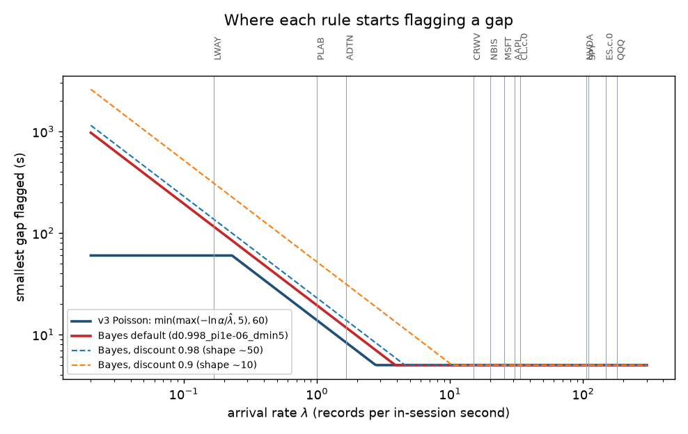
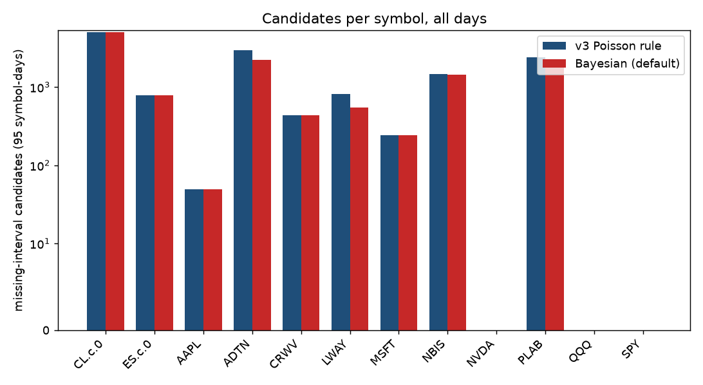
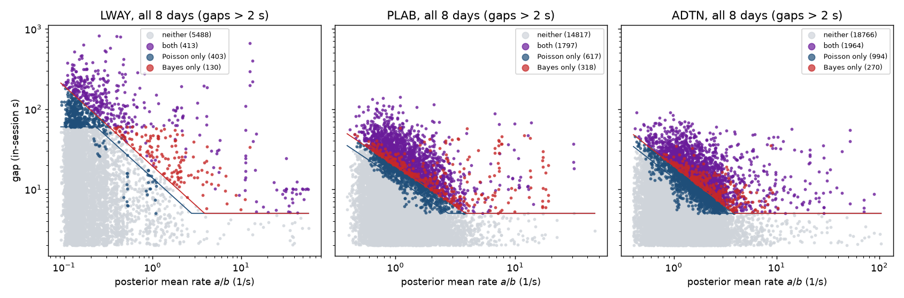
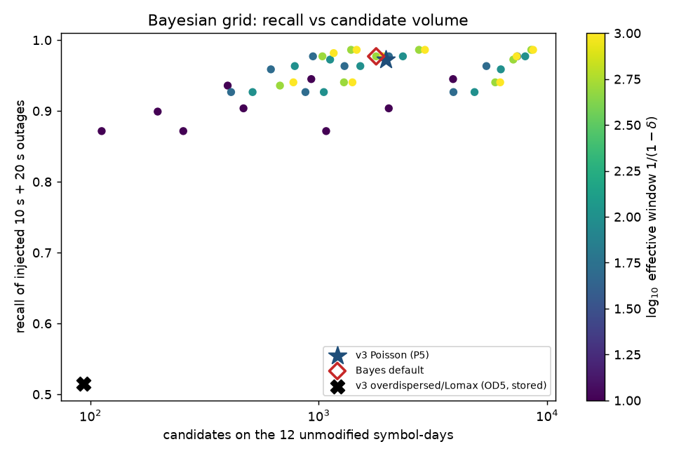

# Milestone 2: Bayesian missing-interval check

Add-only study on the combined-plus tree (same copy as the distribution fits in `docs/m2_distribution_fits.md`). Nothing in Milestone 1, `p115_detectors/`, Yuyang's integration layer, the team pipeline files, or any existing threshold was changed. A flagged gap is a **candidate**, not a confirmed data error.

Code: `m2/bayes/model.py` (model), `m2/bayes/run_bayes_gaps.py` (runs), `m2/bayes/report.py` (tables, plots), `m2/bayes/tests/test_bayes_gaps.py` (11 tests, loaded into the integration suite by `integration/tests/test_m2_bayes.py`). Results: `m2/results/bayes/`, plots in `m2/results/bayes/plots/`.

## Why

The distribution fits showed that inter-arrival gaps are not exponential (Lomax wins most units, lognormal some, exponential never). But the obvious fix, a heavy-tailed Lomax model in the detector (`model='overdispersed'`), lost 41–56% of the injected 10 s and 20 s outages in the v3 sensitivity run. The question here is whether a Bayesian version of the gap check can use the Lomax shape that the data point to, without losing that recall.

## Method

**Gaps.** For each key (publisher, instrument), $g_t$ is the in-session time between consecutive records, using the v3 `SessionClock` (equities RTH with the half-day close; CME Globex hours minus the daily break). This is exactly the input of the v3 `missing_intervals` check, so candidates can be compared gap by gap.

**Normal regime: conjugate Gamma–Poisson.** Arrivals are Poisson with an unknown rate $\lambda$, so a gap is exponential given $\lambda$, and $\lambda$ gets a Gamma prior:

$$g_t \mid \lambda \sim \mathrm{Exp}(\lambda), \qquad \lambda \sim \mathrm{Gamma}(a_0, b_0), \qquad a_0 = m_0,\; b_0 = m_0/\lambda_0 .$$

The prior is weakly informative: $m_0 = 20$ pseudo-gaps at a pooled historical rate $\lambda_0$. $\lambda_0$ is the median `F_LAST` rate of the same symbol on the *other* days of the pull (leave-one-day-out, from `m2/results/summaries.csv`; equities RTH, futures overnight because the Globex session opens overnight). After about 50 gaps the data dominate.

**Updating with a discount (forgetting) factor.** Rates drift within the day, so old gaps should count less. We use the steady Gamma–Poisson discount model (West and Harrison, *Bayesian Forecasting and Dynamic Models*):

$$a_t = \delta\, a_{t-1} + w_t, \qquad b_t = \delta\, b_{t-1} + w_t\, g_t ,$$

with effective window $1/(1-\delta)$ gaps. The default $\delta = 0.998$ gives 500, the same as the v3 `rate_window`. The robust second pass uses $w_t = 1 - P(\text{outage} \mid g_t)$ from the first pass, so an outage does not drag the rate estimate down for the next few hundred records. (The plain pass has $w_t = 1$.) Both passes are linear filters, so the whole thing is vectorised and can also run one record at a time in real time.

**Posterior predictive is Lomax.** Integrating $\lambda$ out of the exponential under $\mathrm{Gamma}(a,b)$ gives

$$P(G > g \mid a, b) = \int_0^\infty e^{-\lambda g}\, \frac{b^{a}\lambda^{a-1}e^{-b\lambda}}{\Gamma(a)}\, d\lambda = \left(\frac{b}{b+g}\right)^{a}, \qquad f_N(g) = \frac{a}{b}\left(1+\frac{g}{b}\right)^{-(a+1)} .$$

So the Bayesian predictive is the Lomax law that won the fits. The difference is where its shape comes from. Here the shape $a \approx 1/(1-\delta)$ measures how much information we have about the current rate. In the v3 overdispersed model it was a moment estimate $\kappa$ from the window's coefficient of variation. That estimate is often close to 1–2, which gives a very heavy tail and makes long gaps look normal. With $a \approx 500$, the predictive is close to exponential in the body and only modestly heavier in the tail.

**Outage regime and posterior probability.** An outage gap is given a scale-free log-uniform length on $[d_{\min}, d_{\max}]$ ($d_{\min} = 5$ s, $d_{\max} = 86{,}400$ s) and a prior probability $\pi$ per gap:

$$f_O(g) = \frac{\mathbf 1\{d_{\min} \le g \le d_{\max}\}}{g\,\ln(d_{\max}/d_{\min})}, \qquad P(\text{outage} \mid g_t) = \frac{\pi\, f_O(g_t)}{\pi\, f_O(g_t) + (1-\pi)\, f_N(g_t \mid a_{t-1}, b_{t-1})} .$$

A gap is a candidate when $P(\text{outage}\mid g_t) \ge 0.5$. Each candidate also carries the predictive tail $P(G > g_t)$ and the posterior rate $a/b$ in its detail. The predictive for $g_t$ uses only the posterior after $g_{t-1}$, so it is causal.

**How it relates to the v3 rule.** At steady state ($a$ large, $b = a/\lambda$), the boundary $P(\text{outage}\mid g) = \tfrac12$ is approximately

$$\lambda g \;\approx\; -\ln \pi + \ln\!\bigl(\lambda g \,\ln(d_{\max}/d_{\min})\bigr),$$

compared with $\lambda g = -\ln\alpha$ for the v3 rule. With $\pi = \alpha = 10^{-6}$, the Bayesian rule asks for roughly 4–5 more mean gaps of silence ($\lambda g \approx 18.7$ instead of $13.8$). The 5 s floor is the outage hypothesis's own lower limit $d_{\min}$. There is no 60 s cap: a long silence is a candidate only if it is unlikely given the name's own rate (see `plots/decision_boundary.png`).

**Default parameters** (`BayesGapConfig`): $\delta = 0.998$, $m_0 = 20$, $\pi = 10^{-6}$, $d_{\min} = 5$ s, $d_{\max} = 1$ day, threshold $0.5$, robust pass on. Each one mirrors a v3 setting (window 500, $\alpha = 10^{-6}$, 5 s floor), so any difference in results comes from the probability model, not from different knobs.

## Data

These are the same 95 symbol-days as the distribution fits (`m2.extract.tasks()`): ten XNAS names over eight sessions, ES and CL over the normal week and the CPI day, and ES around the degraded 2026-08-29 weekend. That is 146.5 million records in total. One symbol-day is loaded at a time.

The v3 Poisson rule is re-implemented for gap-level overlap (`poisson_rule_from_clock`). Its counts equal the stored v3 flag counts in `p115_detectors/results_real_v3/run_index.csv` on **all 95** symbol-days (`summary.txt`; checked again after the 2026-11-22 correction below, and by a regression test). The injected-outage windows and the Poisson detections also equal the stored `sens_v3` P5 run exactly, so the comparison is like for like.

## Results

### Candidates on the real data (95 symbol-days)

> **Correction (2026-11-22).** The first version of this page reported CL 5,100 / ES 738 Poisson candidates and a total of 14,217. That was a bug in the per-day cache of `run_bayes_gaps.py`: `Path.with_suffix` treated `.0_2026-10-05` in `GLBX_ES.c.0_2026-10-05` as a file suffix, so every GLBX day after 2026-10-05 reused the 10-05 result (ES 9 × 82 = 738, CL 6 × 850 = 5,100). The cache is fixed (`_p()`), the GLBX days were recomputed, and the tables below are the corrected ones. XNAS rows and all injected-outage results were not affected. The stored v3 files were always right (CL 4,973, ES 777). See `docs/m2_carryover_decisions.md`, item 6.

| symbol | records | Poisson v3 | Bayes | both | Poisson only | Bayes only | Poisson >60 s | Bayes >60 s |
| --- | --- | --- | --- | --- | --- | --- | --- | --- |
| CL.c.0 | 10,869,822 | 4,973 | 5,028 | 4,856 | 117 | 172 | 6 | 6 |
| ES.c.0 | 56,649,959 | 777 | 778 | 774 | 3 | 4 | 0 | 0 |
| AAPL | 6,005,613 | 49 | 49 | 49 | 0 | 0 | 0 | 0 |
| MSFT | 4,213,161 | 243 | 243 | 243 | 0 | 0 | 0 | 0 |
| CRWV | 3,164,157 | 434 | 434 | 434 | 0 | 0 | 0 | 0 |
| NBIS | 2,928,377 | 1,465 | 1,447 | 1,444 | 21 | 3 | 0 | 0 |
| NVDA, QQQ, SPY | 62,213,976 | 0 | 0 | 0 | 0 | 0 | 0 | 0 |
| ADTN | 229,006 | 2,958 | 2,234 | 1,964 | 994 | 270 | 24 | 24 |
| PLAB | 170,127 | 2,414 | 2,115 | 1,797 | 617 | 318 | 93 | 93 |
| LWAY | 38,142 | 816 | 543 | 413 | 403 | 130 | 698 | 343 |
| **total** | 146,482,340 | **14,129** | **12,871** | 11,974 | 2,155 | 897 | 821 | 466 |

By day type (Poisson → Bayes): normal week 10,190 → 9,527; CPI 1,962 → 1,755; VIX-high 1,281 → 977; half-day 600 → 516; around the degraded weekend (ES) 96 → 96; degraded Saturday 0 → 0.

In plain terms:

- **Liquid names barely change.** On AAPL, MSFT, CRWV, NVDA, QQQ and SPY the candidate set is identical; on ES 774 of 777 are shared (3 Poisson-only, 4 Bayes-only, all 5.3–6.3 s). Their rate is so high that any gap of 5 s or more is overwhelming evidence under either rule, so the 5 s floor decides.
- **CL changes in both directions.** 172 Bayes-only candidates (5.0–24.9 s, median 7.8 s, posterior rate median 3.3/s, median $P(\text{outage}) = 0.99$): the robust update kept the rate up after a nearby gap, while the v3 trailing window had been pulled down by it. 117 Poisson-only candidates (5.1–19.8 s, median 9.1 s) at a posterior rate of about 1.6/s with median $P(\text{outage}) = 0.03$. The six CL silences over 60 s (60.5–113.9 s, 10-06, 10-07 and 10-09) are candidates under both rules.
- **The quiet names are where the rules differ.**
  - *ADTN* goes from 2,958 to 2,234 (−24%). The 994 Poisson-only candidates are mostly 6–19 s gaps (median 10 s) with a posterior outage probability of only about 0.06.
  - *PLAB* goes from 2,414 to 2,115 (−12%). Its Poisson-only gaps have a median of 13.7 s and a median outage probability of 0.09.
  - *LWAY* goes from 816 to 543 (−33%). The 403 Poisson-only candidates are 45–118 s gaps at a posterior rate of about 0.14/s, i.e. about 10 mean gaps. They were flagged only because of the v3 60 s cap. LWAY's empirical $P(G > 60\,\mathrm{s})$ is about 2%, so a one-minute silence is ordinary there. The Bayesian rule still flags every LWAY gap over 300 s; 37 gaps of 120–300 s are not flagged.
- **Bayes-only candidates on quiet names** (ADTN 270, PLAB 318, LWAY 130) occur when the posterior rate is temporarily high (median $a/b \approx 1.5$–$2$/s against $0.14$–$1.5$/s for Poisson-only). These are silences that start in the middle of a burst of activity. A 500-message window on a quiet name spans a large part of the day and cannot see them.







### Injected outages (the v3 sensitivity set)

We used the same 12 symbol-days, injection procedure and random seeds as `p115_detectors/sens_v3.py`. All records of the symbol are deleted for 10 s or 20 s at up to 10 random in-session points per day, 218 outages in total. An outage counts as detected if a candidate with gap ≥ 0.9 L ends within 60 s of the window end.

| model | recall 10 s | recall 20 s | detected / 218 | candidates on the 12 unmodified days | unlabeled candidates on the injected streams |
| --- | --- | --- | --- | --- | --- |
| v3 Poisson (P5, current) | 0.973 | 0.972 | 212 | 1,968 | 3,829 |
| **Bayes default** ($\delta$ 0.998, $\pi$ $10^{-6}$, $d_{\min}$ 5 s) | **0.973** | **0.981** | **213** | **1,783** | **3,471** |
| Bayes, $\delta$ 0.98 (shape ≈ 50) | 0.946 | 0.981 | 210 | 1,296 | 2,533 |
| Bayes, $\delta$ 0.9 (shape ≈ 10) | 0.901 | 0.907 | 197 | 468 | 913 |
| Bayes, $\pi = 10^{-8}$ | 0.928 | 0.953 | 205 | 1,289 | 2,508 |
| Bayes, $\pi = 10^{-4}$ | 0.982 | 0.991 | 215 | 2,747 | 5,364 |
| Bayes, $d_{\min} = 10$ s | 0.973 | 0.981 | 213 | 1,037 | 2,005 |
| v3 overdispersed / Lomax (OD5, stored) | 0.441 | 0.589 | — | 93 | — |

Per symbol-day, the default Bayes run detects the same number of outages as Poisson everywhere except LWAY 10 s (4 vs 5), ADTN 10 s (10 vs 9) and PLAB 20 s (8 vs 7). See `inject_recall_by_symbol_day.csv`.

**Does the Bayesian version avoid the Lomax recall loss? Yes.** With the conjugate shape tied to the effective sample size ($a \approx 500$), recall is 213/218 against 212/218 for the current rule, with 9% fewer candidates on the unmodified days. Shrinking the shape shows where the loss came from. At shape ≈ 50, recall is 210/218; at ≈ 10, it falls to 197/218 (0.90). The v3 overdispersed model, whose moment-estimated $\kappa$ is often near 1–2, fell to 0.44–0.59. A heavy predictive tail is exactly what hides short outages.



The full grid ($\delta \in \{0.9, 0.98, 0.99, 0.998, 0.999\}$, $\pi \in \{10^{-4}, 10^{-6}, 10^{-8}\}$, $d_{\min} \in \{2, 5, 10\}$ s, 45 settings) is in `m2/results/bayes/grid.csv`.

### Synthetic stress stream

On the v3 synthetic stream (1 h, five injected 20 s outages), the Bayesian check finds 5/5 outages with no other candidates, and nothing on the clean stream (test `test_stress_stream_outages_found_and_clean_stream_quiet`). `python run_combined.py --stress` is unchanged: all 41/41 labelled faults are caught.

## Recommendation (not applied)

1. **Report the Bayesian outputs next to the v3 candidates** rather than replacing the rule: the posterior outage probability $P(\text{outage}\mid g)$, the predictive tail $(b/(b+g))^a$, and the posterior rate $a/b$. On liquid names the candidates are identical, so this adds a calibrated probability at no cost.
2. **If the team wants fewer candidates on illiquid names, the default Bayesian setting is the better rule for them.** It keeps injected-outage recall (213 vs 212 of 218), cuts ADTN by 24%, LWAY by 33% and PLAB by 12%, and replaces the arbitrary 60 s cap with a per-name probability. It is causal and recursive, which also answers the real-time item on Yuyang's carryover list for this check.
3. **Keep the shape large.** Do not use small-shape or moment-fitted Lomax tails in the detector. The grid shows recall falling as the shape falls.
4. **Leave $d_{\min} = 5$ s.** $d_{\min} = 10$ s looks attractive (5,707 candidates on 95 days, same recall), but the injected outages are all 10 s or longer, so the test cannot see what is lost between 5 and 10 s. It is effectively a floor change, and that is a policy decision for the team.
5. **Decide on long silences in illiquid names.** Dropping the 60 s cap means a 2–5 minute silence on LWAY is no longer a candidate. If the team wants an absolute "silent for N minutes" alarm, keep it as a separate low-severity rule rather than inside the probability model.

## Limitations

- **The outage prior is not estimated.** $\pi$ and the log-uniform outage law are assumptions; there is no labelled set of real outages. $\pi$ acts like $\alpha$: it trades recall for volume (see the grid).
- **Recall is only measured on synthetic deletions** of 10 s and 20 s in 12 symbol-days, plus the 1 h synthetic stream. Shorter outages, partial outages (thinned rather than silent streams) and outages at the open or close are not tested.
- **The normal regime is a drifting homogeneous Poisson process.** Bursts and self-excitation (Hawkes-type clustering) are not modelled. The discount factor only lets the rate wander. A time-of-day prior, for example from the v3 `tod` buckets, is a natural next step.
- **The prior uses `F_LAST` rates from the fits, while the check uses all records.** The prior is weak ($m_0 = 20$) and is overwhelmed within about 50 gaps, so this only affects the first minutes of a session.
- **No holiday calendar or venue session API** (same as v3). The degraded-Saturday ES window has 18 records and no in-session gaps.
- **The sample is the 95 symbol-day pilot pull,** not a probability sample of all high-frequency data. FOMC and contract-roll days are not included.

## How to rerun

```bash
python -m pip install -r requirements-m2.txt
python -m m2.bayes.run_bayes_gaps --mode real     # 95 symbol-days (about 25 min; caches per symbol-day in m2/results/bayes/cache)
python -m m2.bayes.run_bayes_gaps --mode inject   # 12 symbol-days x 10 s / 20 s outages (about 15 min)
python -m m2.bayes.run_bayes_gaps --mode plots    # summary tables and figures
python -m unittest m2.bayes.tests.test_bayes_gaps
python -m integration.verify --run-tests
python run_combined.py --stress
```
